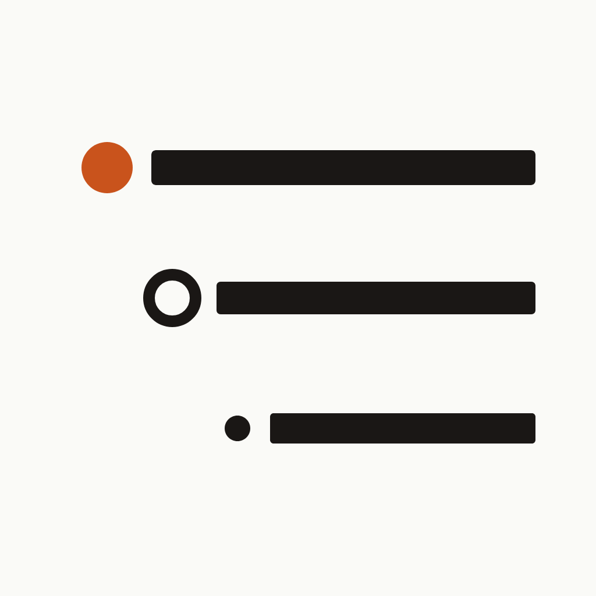
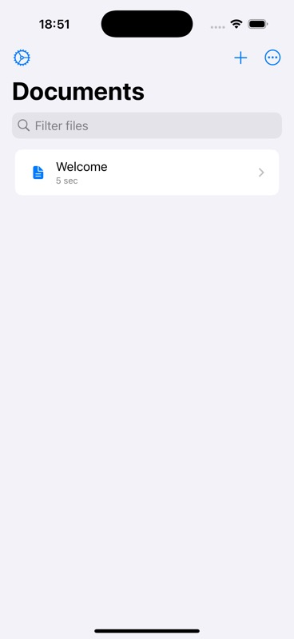
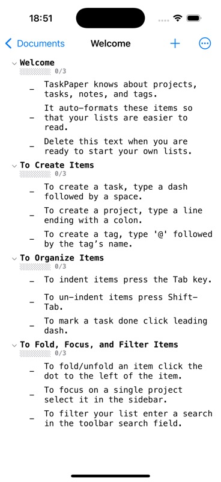

<p align="center">
  
</p>

<h1 align="center">Taskami</h1>

<p align="center">
  A fast, native TaskPaper-compatible outliner for iPhone and iPad.
</p>

Taskami keeps projects, tasks, notes, and metadata in readable plain-text
`.taskpaper` files. There is no proprietary document format and no third-party
runtime dependency.

<p align="center">
  
  &nbsp;&nbsp;
  
</p>

## Highlights

- Native iOS editor with self-sizing rows, drag and drop, undo/redo, and keyboard shortcuts
- TaskPaper projects, tasks, notes, and `@tag(value)` metadata
- Folding and focus mode for navigating large outlines
- Full-text search plus structured queries such as `@due < today`
- Natural-language `@due` and `@start` dates with an inline date picker
- Project progress and `@cost(N)` aggregation
- Light, dark, and sepia themes with configurable typography
- iCloud Drive and Files integration, autosave, OPML import, and HTML export
- Reminders integration, biometric lock, and a Today widget

## Requirements

- iOS 17 or later
- Xcode 16 or later

## Build

1. Clone the repository.
2. Open `Taskami.xcodeproj` in Xcode.
3. Select the `Taskami` scheme and an iOS simulator.
4. Build and run.

The project has no external package dependencies. For device builds and the
widget, choose your own development team and replace the sample bundle and App
Group identifiers with identifiers registered to that team.

## Tests

```sh
# All tests
xcodebuild test \
  -project Taskami.xcodeproj \
  -scheme Taskami \
  -destination 'platform=iOS Simulator,name=iPhone 16 Pro,OS=latest' \
  CODE_SIGNING_ALLOWED=NO

# Unit tests only: add -only-testing:TaskamiTests
# UI tests only: add -only-testing:TaskamiUITests
```

## TaskPaper format

```taskpaper
Inbox:
    - Buy milk @due(today)
    - Call dentist @priority(high)

Launch:
    - Write release notes @done(2026-09-18)
    - Publish build @due(next friday)
    Notes can live alongside tasks without a dash prefix.
```

- A line ending in `:` is a project.
- A line beginning with `- ` is a task.
- Any other line is a note.
- Tags use `@name` or `@name(value)` syntax.

See the [TaskPaper guide](https://guide.taskpaper.com) for the underlying format.

## Contributing

Bug reports and pull requests are welcome. Read [CONTRIBUTING.md](CONTRIBUTING.md)
for the development workflow and [SECURITY.md](SECURITY.md) for responsible
security reporting.

## License

See [LICENSE.md](LICENSE.md). The repository currently uses a public-domain-style
dedication with the additional condition stated in that file; it is not the MIT
license.
